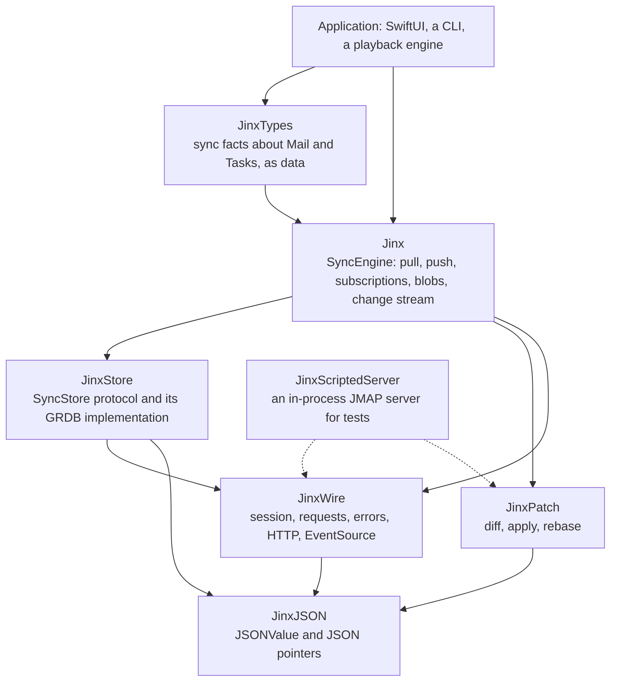

# 1. Orientation

Jinx is a Swift package that keeps a local copy of the JMAP data in one
account and keeps that copy in sync with the server.  An application
reads objects from the local copy and writes to the local copy.  Jinx
carries the writes to the server and the server's changes back, and the
application never sees a request unless it wants to.

That is the whole pitch, and if you have read RFC 8620 it may sound like
less than it is.  The protocol gives you `/get`, `/changes`, `/set` and
`/query`, and each is simple.  What it does not give you is the thing
that has to remember state between them.  That thing is a JMAP client,
and this manual is about how Jinx is one.

## What the spec leaves to you

RFC 8620 is exact about what crosses the wire and silent about what a
client keeps.  Every unit of this manual starts from a problem in that
silence.  Here are the main ones, each with the unit that takes it up.

- **A state string is a promise you must keep.**  `Foo/changes` is only
  useful if you stored the state from last time, applied every change
  that came back, and never let a crash between those steps leave you
  believing you are further along than you are.  Units 6 and 8.
- **`oldState` can disagree with you.**  A `/changes` or `/set` response
  says what the server's state was when it answered.  If that is not
  the state you hold, something happened between your requests, and you
  have to decide what you now believe.  Unit 8.
- **Your own writes are in flight.**  Between sending a `/set` and
  reading its response, the server may tell you about the very change
  you are making, or about a different change to the same object.
  The client has to tell those apart, and it has to do so while the
  user keeps editing.  Units 5 and 9.
- **Other clients write properties you have never heard of.**  If you
  decode an object into your model and encode the model back, you
  erase theirs.  Unit 4.
- **A lost response is not a failed request.**  A create whose response
  never arrived may or may not exist on the server.  Sending it again
  may make two.  Unit 9.
- **The server holds more than you can.**  A mail account does not fit
  on a phone.  `/query` gives you an ordered list of ids, and
  `/queryChanges` is optional.  Deciding which objects to hold, when to
  let them go, and how to keep a list current when the server cannot
  calculate changes is the client's problem.  Unit 10.
- **Blobs are immutable but large.**  Download must resume, the cache
  must have a ceiling, and an object whose `blobId` changes must
  invalidate what was cached under the old one.  Unit 11.

Jinx's answers to these are not independent features.  They rest on one
model of what a synced object is, described in unit 5, and most of the
rest of the library is consequences of that model.

## The cast

Three applications drove the design, and they recur as examples.  They
are real projects, so some details will lag behind their code; what
matters here is what each one demands of a sync library.

**NerfJournal** is a bullet-journal todo app for macOS, with a GUI and a
command-line tool that share one database file.  It syncs JMAP for
Tasks: hundreds to a few thousand Task objects, every one of them held
locally.  It is the full-mirror case.  It is also the case for two
processes on one database, for creates that must not duplicate when a
response is lost (Task has a `uid` for exactly this), and for leaving
alone the properties that other clients put on a Task.

**Juke** is a music server and an iOS player.  Its types, Track and
Playlist, are its own, not from any RFC.  About forty-five thousand
Tracks of metadata are held in full, and a Playlist is a server-side
query over Tracks, so Track must sync before Playlist.  The audio is
hundreds of gigabytes, of which the device holds a pinned subset plus a
cache.  Juke is the case for application-defined types, declared sync
order between types, blobs, and progress reporting over a long initial
sync.

**MailRoom** is a mail client experiment against Fastmail.  Mailbox is
held in full.  Email and Thread are windowed: held only while a query
the app is showing, or a pin the app has placed, wants them.  MailRoom
is the reason windowed mode exists, the reason an Email body is fetched
separately from its summary, and the reason Jinx has no opinion about
how an app models an Email.

The requirements of all three are gathered in
[`doc/consumers.md`](https://github.com/rjbs/Jinx/blob/main/doc/consumers.md).

## What Jinx is not

Jinx has no user interface and no SwiftUI types.  It does not sanitize
HTML.  It does not know about any particular server's quirks, and a
server that implements the RFCs is the only server it targets.  It does
not ship typed Swift models of Email or Task; those belong to the apps,
and Jinx is generic over JSON.  It has no query language of its own: an
app small enough to filter in memory reads every object of a type, and
a larger one runs SQL against Jinx's tables, whose layout is documented.
And it runs only on Apple platforms, iOS 27 and macOS 27 or later.

## The stack

Jinx is one package with six library modules and a test server.  Each
module depends only on the ones below it, and each lower module is
usable without the ones above.



| Module | What it holds | Size |
|---|---|---|
| `JinxJSON` | `JSONValue`, the one JSON representation, and JSON pointers | small |
| `JinxWire` | The session, request building, back-references, typed errors, the URLSession transport, EventSource | medium |
| `JinxPatch` | Diff, apply, rebase, owned properties; pure functions over `JSONValue` | small |
| `JinxStore` | The `SyncStore` protocol, the records it stores, and `GRDBSyncStore` | medium |
| `Jinx` | The `SyncEngine` actor: pull, push, writes, windowed sync, blobs, the run loop | the largest |
| `JinxTypes` | Type descriptors for Mail and Tasks | tiny |
| `JinxScriptedServer` | A small, correct JMAP server that lives in the test process | medium |

The division is not decoration.  An app that only wants to send a
hand-built request can use `JinxWire` alone, and a test of the patch
algebra links nothing but `JinxPatch` and `JinxJSON`.  The test server
sits beside the stack rather than on top of it, so that it can be
reimplemented later without depending on the engine it tests.

## A sync from the outside

Here is the shape of a program that uses the whole stack.  Every line
is expanded somewhere later in the manual; for now, read it for what
it does not contain.

```swift
import GRDB
import Jinx
import JinxStore
import JinxTypes
import JinxWire

let store = try GRDBSyncStore(path: databasePath)

let transport = JMAPClient(
  sessionUrl: URL(string: "https://api.fastmail.com/jmap/session")!,
  authenticator: BearerToken(token)
)

let configuration = SyncConfiguration(accountId: accountId, types: TaskTypes.all)
let engine = try SyncEngine(configuration: configuration, transport: transport, store: store)

Task { await engine.run() }

Task {
  for await changeSet in engine.changes() {
    // created, updated and destroyed objects, by type and local key
  }
}

let key = try await engine.create("Task", [
  "uid": .string(UUID().uuidString),
  "title": "Write the manual",
])
```

There is no request in it.  There is no state string, no `/changes`
call, no `/set`, no response handling.  The app names the account and
the types, opens a database, and says what it wants to happen.

What happens is this.  The run loop fetches the session resource and
runs a first pass.  There is nothing to push.  Task has no stored
state, so the pull is an initial sync: page through `Task/query` and
fetch the pages with `Task/get`, committing each chunk as it lands and
reporting it on the change stream, until the state string from the
last `/get` can be stored and `Task/changes` can take over.  The create
writes a row to the local store, appends a pending entry to a log,
emits a change set with a `local` source, and asks the run loop for a
pass.  After a short debounce, the push reads the entry, builds
`Task/set` with one create, sends it, and on success writes the server's
id into the row and emits a change set that says so.  If the device is
offline, the entry waits.  If the user edits the task three times
before the push, one patch goes.  If the server has changed the task in
the meantime, the pending edit is rebased onto what the server sent.

None of that is visible in the code above, which is the point.  The
rest of this manual makes it visible.

## Vocabulary

This manual uses the names the code uses.  A few are worth fixing now,
since the design document used other words for some of them.

- A **synced object** is one JMAP object as Jinx holds it, with its
  metadata.  The type is `SyncedObject`.  The design called it a cell.
- A **local key** is the stable `Int64` identity Jinx assigns to an
  object the moment it exists locally.  The **id** is the JMAP id,
  which an object may not yet have.  The type is `LocalKey`.
- A **pending entry** is the record that an object has a local change
  the server has not accepted.  There is at most one per object.
- A **sync pass**, or just `sync()`, is one push followed by one pull.
- A **change set** is what the engine emits after each commit: which
  objects changed, from what source.  The type is `ChangeSet`.
- A **type descriptor** is what an app tells Jinx about a type.  The
  type is `TypeDescriptor`.
- A **subscription** is a query the engine keeps current for a windowed
  type.  The type is `QuerySubscription`, and its result is a `Window`.

The [glossary](glossary.md) collects these and the rest.

## Where things live

- The source is under `Sources/`, one directory per module.  The
  [file map](file-map.md) lists every file.
- The tests are under `Tests/`, one target per module.  `swift test`
  runs them all, and most units of this manual name a test that shows
  the behavior described.
- The design is `doc/plan.md`, and it is older than the code.  Where
  the two disagree this manual follows the code and says so in a
  callout like this one:

!!! info "Not yet as designed"
    The plan describes least-recently-used eviction for windowed types
    and a tracked fetch level per object.  The code evicts immediately
    when nothing retains an object, and fetches extra properties on
    demand without recording that it did.  Both are open threads.

Next: [One JSON](02-json.md).
