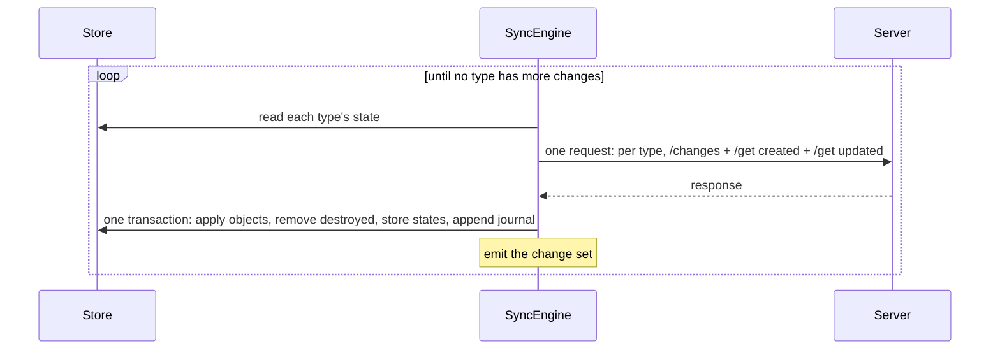

# 8. Sync in

Unit 3 ended with a sync-in assembled by hand and a list of what it did
not do: check `oldState`, loop on `hasMoreChanges`, handle destroyed
ids, chunk the fetches, survive `cannotCalculateChanges`, notice
pending edits, and store anything.  This unit is the engine's sync-in,
which does all of them, and it is best read as that list worked
through in order.

## A pass

`sync()` is one pass, and a pass is a sync-out followed by a sync-in.  The
order is deliberate: a sync-in that runs against a server that already
has the client's changes has less to rebase.  A sync-out that fails for a
retryable reason does not skip the sync-in.  The pending entries are
kept, they will rebase onto whatever the sync-in brings, and the app gets
fresh data while its writes wait.  The sync-out's failure is rethrown
after the sync-in so the run loop can back off.

The sync-in itself begins by sorting the configured types, already in
dependency order, into three groups: windowed types, which unit 10
takes up; full types with no stored state, which need an initial
sync; and full types with a state, which get `/changes`.

## Incremental rounds

A round is one request for every type that still has changes to
fetch.  For each such type the request carries three calls, which are
the three from unit 3 with one addition:

```swift
let changes = builder.call("\(type)/changes",
  .changesArguments(accountId: accountId, sinceState: state, maxChanges: chunk))
let created = builder.call("\(type)/get", descriptor.getArguments(accountId: accountId, ids: []),
  references: ["ids": changes.reference("/created")])
let updated = builder.call("\(type)/get", descriptor.getArguments(accountId: accountId, ids: []),
  references: ["ids": changes.reference("/updated")])
```

The addition is `maxChanges`, set to the fetch chunk, which is the
server's `maxObjectsInGet` or a smaller configured value.  Because a
`/changes` returns at most that many ids, each back-referenced `/get`
asks for at most that many objects, and the request can never draw
`requestTooLarge` however large the delta.  Chunking falls out of the
protocol's own limit, with no second request to split.



The response is applied in one transaction across every type in the
round, and that transaction decides, per type, which of the following
happened.

- **No response to the `/changes`.**  The round failed; the pass
  throws a retryable error and nothing for this type is stored.
- **A method error.**  `cannotCalculateChanges` puts the type on the
  resync list.  Any other error is classified as unit 9 describes:
  permanent errors abort the pass, retryable ones end the round.
- **`oldState` is not the state we sent.**  The server's answer is
  about a different baseline than the one we hold.  This type's
  results are discarded and it stays in the round for another try.
  After five such rounds the pass gives up as retryable, with the
  message "state kept moving during sync-in", on the theory that
  something else is wrong.
- **Otherwise**, every fetched object goes through `applyFetched`,
  which is the table in unit 5: insert, replace, rebase, skip if
  another process holds the claim, or adopt by client identity.
  Every destroyed id goes through `applyDestroyed`, which deletes the
  row and, by cascade, its pending entry.  The new state is stored,
  in the same transaction.  If `hasMoreChanges` is false the type is
  done; otherwise it goes round again.

The plan described discarding the whole response when any type's
`oldState` mismatched.  The code is finer: types that matched are
applied, and only the mismatched ones retry.  Since each type's state
is independent, nothing is lost by applying what was consistent.

A pass runs at most two hundred rounds.  The cap exists so that a
server that reports `hasMoreChanges` forever cannot hold the engine
in a loop, and no server has come near it.

## Initial sync and resync

A full type with no state, and a full type whose `/changes` drew
`cannotCalculateChanges`, go through `fullFetch`.  It is the same code
in both cases, which is the first thing to know about resync: it is an
initial sync that happens to find objects already there.

The first attempt is a single `/get` with `ids: null`, which the RFC
allows a server to refuse with `requestTooLarge`.  Small types, such
as Mailbox or NerfJournal's Task, come back in one response.  When
the server refuses, the engine pages instead: `/query` with no filter,
a position and a limit of one chunk, back-referenced into a `/get`,
with `calculateTotal` on so the status can show a fraction.

Each chunk is committed on its own, and that is the one deliberate
exception to one-transaction-per-pass.  Juke has forty-five thousand
tracks, and an app should be able to draw the first chunk while the
rest arrive.  The engine's status carries an `initialSync` entry per
type with `fetched` and `total` while this is happening, and it is
removed when the fetch ends.

The state stored at the end is the one the first `/get` reported.
Anything that changed on the server during a long paged fetch is
therefore not lost: the next pass asks `/changes` since that state
and picks it up.

Resync never wipes.  Every fetched object goes through the same
`applyFetched` as a sync-in, so an object with a pending edit is rebased
rather than replaced, and the user's unpushed change survives a state
the server forgot.  After the last chunk, one more transaction deletes
every object of the type the server did not return, except those with
a pending create, which the server has never seen and cannot have
reported.  A reader of the store sees a type that is never
half-updated, only a sequence of consistent states that converge on
the server's.

## Status and what the app sees

Every committed round and chunk emits a change set with source
`sync-in`.  `currentStatus()` returns a `SyncStatus` with `lastSyncIn`,
`lastSyncOut`, `pendingCount`, `lastFailure` and the `initialSync`
progress map.  There is no "syncing" boolean; an app that wants a
spinner watches `initialSync` for a long fetch and otherwise does not
need one, because a sync-in is a few hundred milliseconds and the change
stream says when it landed.

## Where to look

- `Sources/Jinx/SyncIn.swift`: `syncIn()` sorts the types, `syncInChanges`
  is the round loop, `fullFetch` is initial sync and resync, and
  `applyFetched` is the merge.
- `swift test --filter JinxTests.SyncInTests`.
  `incrementalSyncInAppliesCreatesUpdatesAndDestroys` is one round;
  `pagedChangesLoopUntilDone` is `hasMoreChanges`;
  `initialSyncPagesWhenGetIsTooLarge` is the `requestTooLarge` path;
  and `cannotCalculateChangesResyncsWithoutWiping` is the sentence
  "resync never wipes", with a pending edit that survives.

Next: [Sync out](09-sync-out.md).
