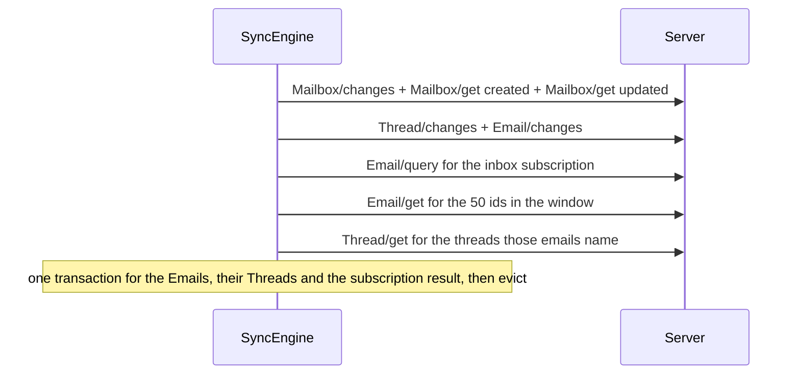

# 14. Capstone

This unit builds a small mail client's sync layer from an empty
database to a synced inbox, touching every module once, and shows
what goes over the wire at each step.  It is MailRoom's shape, reduced
to what Jinx sees.  Nothing here is new; every mechanism was explained
in an earlier unit, and the point is to see them run in order.

## Setup

The account id has to be known before the engine exists, and it comes
from the session, so the first thing the app does is use the wire
module directly:

```swift
let transport = JMAPClient(
  sessionUrl: URL(string: "https://api.fastmail.com/jmap/session")!,
  authenticator: BearerToken(token)
)
let session = try await transport.fetchSession()
guard let accountId = session.primaryAccountId(for: MailTypes.capability) else { fatalError() }
```

Then the store, the descriptors, and the engine:

```swift
let store = try GRDBSyncStore(path: databasePath)

let configuration = SyncConfiguration(
  accountId: accountId,
  types: [MailTypes.mailbox, MailTypes.thread, MailTypes.email()],
  signalName: "org.example.mailroom.\(databasePath.hashValue)"
)
let engine = try SyncEngine(configuration: configuration, transport: transport, store: store)
```

`MailTypes.email()` with no arguments is the summary descriptor: the
list properties, no bodies.  The signal name is only needed if a
second process will share the file, but it costs nothing.

## The first pass

The inbox subscription needs the inbox's id, and the inbox is a
Mailbox, which is a full type, so one pass has to run before the
subscription can be declared.

```swift
try await engine.sync()
let inbox = try await engine.objects(type: "Mailbox").first { $0.value["role"] == "inbox" }!
```

That pass made three requests.  The sync-out had nothing to send.  The
sync-in sorted the types: Mailbox has no state and is full, so it went
through initial sync, which is one `Mailbox/get` with `ids: null`
since a mailbox list is never too large.  Thread and Email are
windowed and had no state, so one request asked each for an empty
`/get` to learn a state string.  Then the windowed round asked
`Thread/changes` and `Email/changes` since those states, which
reported nothing, and with no subscriptions and no pins there was
nothing to fill and nothing to evict.

```json
["Mailbox/get", {"accountId": "a1", "ids": null}, "c0"]

["Thread/get", {"accountId": "a1", "ids": []}, "c0"]
["Email/get",  {"accountId": "a1", "ids": [], "properties": ["id", "blobId", "threadId", "…"]}, "c1"]

["Thread/changes", {"accountId": "a1", "sinceState": "t100", "maxChanges": 256}, "c0"]
["Email/changes",  {"accountId": "a1", "sinceState": "e100", "maxChanges": 256}, "c1"]
```

The change set from this pass has source `syncIn` and created keys for
every Mailbox.  The app can draw the folder list.

## Subscribing

```swift
try await engine.subscribe(QuerySubscription(
  id: "inbox",
  accountId: accountId,
  type: "Email",
  filter: ["inMailbox": .string(inbox.id!)],
  sort: [["property": "receivedAt", "isAscending": false]],
  limit: 50,
  arguments: ["collapseThreads": true]
))

Task { await engine.run() }
```

`subscribe` stores the definition and requests a pass; `run` starts
the loop, which runs that pass after its debounce.  This pass is the
interesting one.



The query is the subscription's arguments with the engine's on top:

```json
["Email/query", {
  "accountId": "a1",
  "filter": {"inMailbox": "mb-inbox"},
  "sort": [{"property": "receivedAt", "isAscending": false}],
  "limit": 50,
  "calculateTotal": true,
  "collapseThreads": true
}, "c0"]
```

The fill is a `/get` of the ids the query returned that are not yet
held, which is all fifty, chunked to `maxObjectsInGet`.  The
references step reads `threadId` from each fetched Email and fetches
the Threads, because the Email descriptor declares `threadId` as a
reference and nothing holds those Threads yet.  `mailboxIds` is also
a reference, but every Mailbox is already held.

The change set has source `syncIn`, fifty created Email keys, as many
created Thread keys, and `subscriptions: ["inbox"]`.  Any consumer
watching the stream reads the window:

```swift
let window = try await engine.window(of: "inbox")!
window.result.total        // 1204
window.objects.count       // 50, in receivedAt order
window.missingIds          // [], or the ids a /get reported notFound
```

## Opening a message

The summary has no body.  When the user opens a message, the app
fetches it again with the body arguments, and pins it so the next
pass does not evict it if it scrolls out of the window:

```swift
try await engine.pin("Email", ids: [email.id!])
let full = try await engine.fetch("Email", ids: [email.id!], arguments: [
  "fetchHTMLBodyValues": true,
  "maxBodyValueBytes": 250_000,
])
```

That is one `Email/get` with the summary properties plus those
arguments, and the result replaces the local value with one that
carries `bodyValues`.  The Thread is already held, by reference, so
the other messages in the conversation can be found through its
`emailIds` and pinned and fetched the same way.

## Marking it read

```swift
try await engine.update(email.key, patch: ["keywords/$seen": true])
```

The write path applies the patch to the local value, sees that it
differs from the server version, appends a pending `update` entry, commits
a change set with source `local`, and requests a pass.  The UI
updates at once from that change set, with `pending` set on the
object.  After the debounce the sync-out claims the entry, diffs server version
to local, and sends:

```json
["Email/set", {
  "accountId": "a1",
  "update": {"M9f3": {"keywords/$seen": true}}
}, "c0"]
```

The response's `updated` confirms it; the server version becomes the sent
value, the entry is cleared, and the change set with source `syncOut`
names the key.  Because this process changed an Email, the next
windowed round re-runs the inbox query even though `Email/changes`
will report only our own change, in case the server's answer to the
filter moved.

## Archiving

```swift
try await engine.update(email.key, patch: [
  "mailboxIds/\(inbox.id!)": .null,
  "mailboxIds/\(archive.id!)": true,
])
```

Same path, one `/set` with two patch entries.  On the next sync-in the
inbox query no longer lists the message, the subscription result
changes, and the message is evicted at the end of the pass, unless
it is still pinned because the user is still looking at it.  The
change set names the subscription and, if evicted, the destroyed key.

## Offline

Nothing above assumed a network at the time of the write.  With the
radio off, the reads, the pin, and the two updates all succeed against
the local store; the two updates collapse into one entry, since they
touch the same object; the sync-out fails with a transport error, the
claim is released, and the run loop backs off.  When the network
returns, a pass syncs out one `Email/set` with three patch entries and
then syncs in.  If another client marked the same message read in the
meantime, the sync-in rebases: `keywords/$seen` is pending locally and
wins, the server's value for it is the same anyway, and every other
property takes the server's.

## What the app wrote

About forty lines: the session fetch, the configuration, one
subscription, three calls on the engine, and a `for await` on the
change stream.  It wrote no request, parsed no response, stored no
state string, and has no code that runs differently offline.  What
the rest of this manual described is what those forty lines bought.

Where to go next depends on what you are building.  An app with its
own types starts at unit 7 and writes a descriptor.  An app with
large files starts at unit 11.  Anyone changing the engine starts at
unit 5 and reads the tests in unit 13 before the code.
